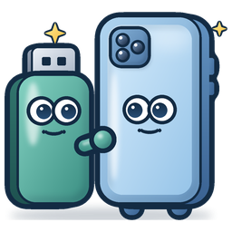
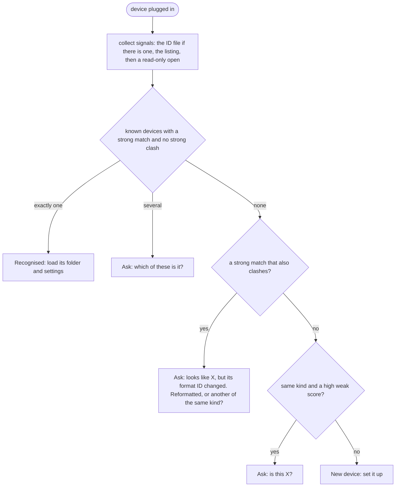

  

# Plug-n-Keep: design

## 1. What it is

A desktop app for Windows, Linux and FreeBSD ([§4.1](#41-platforms)). It backs up a USB device to
a folder on the computer or in an S3 bucket ([§11](#11-backup-destinations)), and keeps everything
that was ever on it.

- You plug in a device: a phone, a camera, a USB stick, an SD card or a USB drive.
- The app recognises a device it has seen before, and loads its backup folder and settings.
- A sync copies what's new to the backup folder. Files deleted from the device are moved into an
  archive folder inside the backup (the default), left where they are, or sent to the Recycle Bin
  (the Trash on Linux and FreeBSD), per device.
- Nothing is ever deleted for good, and nothing on the device is changed.

Safety rules are in [§2](#2-the-promises), code layout in [§10](#10-code).

## 2. The promises

Every device kind keeps these.

1. **The device is read-only.** The app opens it read-only. Two exceptions:
   - **One you choose.** On a USB stick or drive it can't identify for certain, the app may ask to
     write one small ID file ([§5.4](#54-the-id-file)). It never writes anything else, and never
     writes to a phone.
   - **One the phone makes.** The first time an iPhone is connected it asks its own "Trust This
     Computer?" question. If you tap Trust, a pairing record is saved on the phone and the PC. The
     phone's dialog makes it, not the app, and without it the phone shows no files. On Windows,
     Apple's driver does the same.
2. **Nothing in the backup is overwritten or deleted for good.** What leaves its place in the
   backup (a file deleted from the device, or the old copy of a changed one) goes where the
   device's setting says ([§6.3](#63-the-archive-folder)):
   - **Archive** (default): into the archive folder, inside the backup.
   - **Leave in place:** a deleted file stays; a changed file's old copy is renamed beside the new
     one. Nothing leaves the backup folder.
   - **Recycle Bin / Trash:** the file leaves the backup folder and can be restored. It is never a
     permanent delete: if the bin can't take a file (none on that drive, too big, a network
     share), the file stays where it is and the app says so. A bucket has no bin
     ([§11](#11-backup-destinations)).
3. **A file is saved whole, or not at all.** It is copied to a temporary file that must be exactly
   the size the device reported, flushed to disk, and moved into place without replacing anything.
   In a bucket an upload appears only when finished, and never replaces a file
   ([§11](#11-backup-destinations)).
4. **One backup folder per device.** A marker file in the folder says which device it belongs to.
   A different device is refused, so one device's files are never archived as "deleted" from
   another's.
5. **Stop and Skip are safe.** If a transfer stops part-way through a file, the connection is
   treated as spoiled: nothing more is asked of it (no read, listing or re-check) and the app
   reopens it. (On an iPhone, an abandoned transfer makes every later read return the previous
   file's data.)
6. **Also:** crash recovery of a half-copied file; the skip list, Problems tab and Log panel; one
   copy of the app at a time; a confirmation before archiving a large batch.

## 4. Devices

Two families: **phones and cameras** (MTP or PTP, read through a protocol API) and **storage**
(USB sticks, SD cards, USB drives, cameras in storage mode, read through the file system). The
kind sets only defaults (what to back up, how to compare, archive layout). Nothing that keeps data
safe depends on it, because a device can claim to be anything.

**Phones and cameras.**
- The phone must be unlocked. An iPhone must also trust the PC. An Android phone must be in **File
  transfer** mode; in any other mode it shows no files, and the app says so instead of showing an
  empty device.
- A phone may have several storages ([§6.1](#61-layout)). Object IDs can't be kept between
  sessions, so everything kept between sessions is keyed by path.

**Storage.**
- On Windows, WPD also lists USB drives; the app hides that duplicate, so each stick appears once.
- The system drive is never offered, and a drive that holds the chosen backup folder is refused as
  a source. A backup folder and the folder a device is read from must not contain one another,
  or the backup would be read as device files (or the device as backup content); this is refused
  before anything is listed.
- No links are followed and no handle is kept open between scans and syncs, so the system's
  **Eject** or unmount still works.
- Before every listing and read, the app checks that the folder is still the volume it opened, so
  a different stick at the same place is refused and a file system mounted inside it is not
  entered.

**Eject.** The button is enabled only when no scan or sync runs; phones and cameras have none. The
app drops everything it holds on the device, then only asks the system to eject. It never opens
the volume for writing, locks it or dismounts it ([§10.3](#103-how-it-stays-read-only)), and it
never ejects the wrong thing: a stick behind a hub is ejected at its own device node, never the
hub, and Linux refuses a drive holding `/`, `/boot`, `/usr` or `/home` or with an open encrypted
or LVM volume. The logic is in `core/src/platform/windows/eject.rs` and
`core/src/platform/linux/eject.rs`.

### 4.1 Platforms

Windows 10 and 11, Linux (tested on Ubuntu) and FreeBSD.

| | Windows | Linux | FreeBSD |
|---|---|---|---|
| **Sticks, SD cards, drives** | the file system | mounted file systems (udisks2 mounts them) | mounted file systems (automount) |
| **Android (MTP)** | WPD | `libmtp` | `libmtp`, from ports |
| **iPhone** | WPD, through Apple's driver | `usbmuxd` and AFC | `usbmuxd` and AFC, from ports |
| **Cameras (PTP)** | WPD | `libgphoto2` (optional, loaded at run time); also in storage mode or through a card reader | in storage mode or through a card reader |
| **Eject** | `CM_Request_Device_EjectW` | udisks2 over D-Bus: `Unmount`, then `PowerOff` | none: the system's own |
| **Plug-in events** | `CM_Register_Notification` | kernel uevent socket, plus a poll of mounted volumes | a poll of mounted volumes |
| **Settings and state** | `%APPDATA%\plug-n-keep\` | `~/.config/plug-n-keep/` | `~/.config/plug-n-keep/` |

- **An iPhone looks different on each system.** Through Apple's Windows driver it shows month
  folders and may convert photos to JPG; on Linux and FreeBSD it shows its own `DCIM` folders and
  original files. The marker records which **view** a backup folder was made with
  ([§6.2](#62-the-marker)). The app refuses to sync a folder through a different view, explains,
  and suggests a separate folder.
- **Names stay Windows-safe on every system**, and are compared ignoring case everywhere, so a
  backup folder can move between systems or live on an exFAT drive. On Linux, where the disk
  itself tells `DCIM` and `dcim` apart, a file that is already in the backup is written under the
  backup's spelling of its folders, and so is a new file under a device folder that those files
  were matched across case. Two folders on the device that differ only in case are never merged
  by this: each stays its own folder.

## 5. Recognising a device

### 5.1 What the app collects

Recognition uses signals that identify a device, each strong or weak. Strong ones (an ID file, a
device or USB serial, a partition or volume ID) rarely change; weak ones (model, name, label,
capacity) can. None needs admin rights. The signals collected per platform and how each is graded
are in `core/src/signals.rs`, with the platform code under `core/src/platform/`.

- **The ID file is the strongest** ([§5.4](#54-the-id-file)).
- **Serials that aren't real are never trusted:** one Windows invented, a placeholder (all zeros,
  one repeated character, too short), or one already seen on two known devices (some cheap sticks
  share one across a batch). They count only as weak.
- A FAT or exFAT stick keeps the same volume serial on every system, so it is recognised across
  systems.

### 5.2 Matching

For each known device, the app compares only the signals both sides have:
- **strong match:** a strong signal is equal on both;
- **strong clash:** a strong signal of the same type differs;
- **weak score:** how many weak signals are equal.

- **Recognised** is shown, not hidden, with how it was recognised. A **Not this device?** link
  corrects it.
- **Every answer is remembered.** Confirming a match adds the new signal values to that device.
  Saying it's a different device stops it being proposed again.
- **The new-device card offers "It's one I already back up…"**, for one memory card that shows up
  as a camera one day and a card reader the next.
- **Recognition never starts copying by itself.** At most it starts a scan, which only reads
  ([§8](#8-the-window)).
- **The scan is a second check.** Archiving asks first if the device was matched only by weak
  signals, or if fewer than half of the backup's files are on the device. Either can mean the
  wrong device or a wiped one. The other cautions are in [§7.5](#75-safeguards-that-change)
  (`Caution` in `core/src/plan.rs`).

### 5.3 When the app's own records are lost

Nothing important is kept only in the app-data folder. Each backup folder holds its device's whole
record ([§6.5](#65-the-device-record-and-the-history), [§9](#9-what-it-stores-on-the-computer)).

On a new PC, or after the app-data folder is lost, **Add an existing backup…** (or **Find my
backups**) reads a backup folder or a place in a bucket, or the markers one level below it, and
sets each device up again. Both look in the folder itself and in the folders directly inside it, never deeper, and
recognise a backup by its `.plug-n-keep.json` marker. A device plugged in afterwards is recognised
exactly as before. If a known device's folder
has moved, the app says so and you point it at the new place; the marker confirms it's the right
one.

### 5.4 The ID file

The only thing the app ever writes to a device, and only with your say-so, and only to a stick.

- **Offered, never assumed.** The app asks each time; No is the default. It is offered for a new
  stick with nothing strong to go on, after you answer a "which is it?" question for a stick, and
  at any time from the device's menu (**Write ID file**). Phones never get one.
- **One new file** (`.plug-n-keep-id`, hidden, at the top of the stick). It is never written over
  an existing file, nothing else on the stick is touched, and it is flushed before success is
  reported. If the write fails, the app removes its own part-written file and recognises the stick
  by its other signals. Its content is in `core/src/idfile.rs`.
- **The scan never copies it** or counts it as a file of yours.
- **Read first on plug-in.** A matching ID is the strongest match there is. An ID from another PC
  offers to set the stick up under that ID. A cloned stick (same ID, clashing format ID or USB
  serial, or two sticks with one ID) asks, and offers to write a new ID on the copy. That is the
  only time the app replaces the file, and only on your yes.
- **A damaged ID file** counts as none, and is listed under Problems.
- You delete it yourself. **Forget** never touches the stick.

## 6. The backup folder

### 6.1 Layout

The backup mirrors the device's own folders, for the parts chosen in
[§7.1](#71-what-to-back-up).

- **One storage** (an iPhone, most sticks): files go at the top of the backup folder.
- **Several storages** (an Android phone with an SD card): each gets a folder, such as
  `Internal shared storage\DCIM\Camera\…` and `SD card\DCIM\…`.
- The choice is made once, at setup, and stored with the device. A storage that turns up later
  gets its own folder and never moves existing files.

### 6.2 The marker

`.plug-n-keep.json` sits at the top of the backup folder. It is a claim on the folder: written by
the first sync as a temporary file moved into place without replacing anything, and changed only
on a hand-over or an archive rename. It holds:
- the device's ID and name, and its first signals, for "Find my backups";
- `archive_names`: every name the archive folder has had in this folder
  ([§6.3](#63-the-archive-folder));
- `view`: how the device was read. The app refuses to sync through another view
  ([§4.1](#41-platforms));
- whether the folder already held files, until an archive has been confirmed
  ([§7.5](#75-safeguards-that-change)).

Its fields are in `core/src/owner.rs`.

### 6.3 The archive folder

**What happens to files deleted from the device is chosen per device** (`deleted_files`). The same
choice covers the old copy of a changed file ([§7.3](#73-a-file-that-changed)):

| Choice | A file deleted from the device | The old copy of a changed file |
|---|---|---|
| **Archive** (default) | moved into the archive folder | moved into the archive folder |
| **Leave in place** | left in the backup folder; nothing moves, so nothing asks | renamed beside the new copy as `name (old <date time>)`, numbered if taken |
| **Recycle Bin** (Trash on Linux and FreeBSD) | sent to the bin | sent to the bin; the new copy takes its place |

There is no permanent-delete choice. The archive name and layout matter only for **Archive**, and
keep their values when another choice is made. A bucket offers only **Archive** and **Leave in
place** ([§11](#11-backup-destinations)).

**The bin is never a way to delete.** It is the one place the app asks the system to move a file
somewhere it doesn't control, so each move is guarded:
- **Windows:** a move counts as done only if Windows confirms the file went to the bin. If it would
  be destroyed instead (no bin on the drive, too big, a network path), the operation is refused.
  (`core/src/platform/windows/trash.rs`.)
- **Linux and FreeBSD:** the freedesktop.org Trash specification, with no library that could fall
  back to deleting, and never a copy across file systems: with no usable trash on the file's own
  file system, the file stays where it is. (`core/src/platform/unix_trash.rs`.)
- **Both:** a file the bin can't take is left in place and the message says so; for a changed
  file, nothing is replaced then.

Each sync that archives anything gets a new dated folder, `<archive name>\<YYYY-MM-DD HH-MM-SS>\…`,
always inside the backup folder.

**The archive's name** is set per device (the default for new devices is `_Archive`). It must be
one safe Windows name and not one the device uses at the top of the backup
(`app/src/validate.rs`, `core/src/owner.rs`). The app offers to rename the folder on disk too, as
one move after the same checks as any archive move (not in a bucket, where it would copy every
file in it). The marker keeps every name it has had, and a
folder under any of them is never treated as backup content. Otherwise the old archive would look
like files deleted from the device, and be archived.

**Layout inside a dated folder**, per device: **Keep folders** (default; the device's sub-folders
are re-created, which a stick needs because many files share a name) or **Flat** (every file
directly in it, clashing names numbered).

### 6.4 What the scan never treats as backup content

- The app's own state files in the backup folder and the temporary files of a copy in progress
  (listed in [§6.5](#65-the-device-record-and-the-history) and
  [§7.6](#76-jpg-copies-of-heic-photos)). They are matched by name at the top of the folder
  (`owner::is_marker_name`), so they are never indexed, compared, copied, archived or binned, and
  no archive folder can be given one of these names.
- Every archive folder named in the marker, at any depth.
- A folder inside the backup that has its own marker: another device's backup, left alone and
  listed under Problems.
- The old copies **Leave in place** keeps beside a changed file. They are the backup's own doing,
  so are never listed as deleted from the device, and stay put if the device is later switched to
  Archive or the bin.
- PC clutter (`desktop.ini`, `Thumbs.db`, `.DS_Store` and other entries on an editable ignore
  list). Otherwise Explorer's own files would be archived as "deleted from the device".

### 6.5 The device record and the history

The backup folder is the source of truth for the device that backs up to it. These hidden files sit
at its top, each written through a temporary file and an atomic move:

| File | What it holds |
|---|---|
| `.plug-n-keep.json` | the owner marker ([§6.2](#62-the-marker)) |
| `.plug-n-keep-device.json` | the device's record: ID, name, kind, how it was read, the signal history that recognises it, the "not this device" answers, first and last seen, last sync, and all its settings. Not the backup folder's own path |
| `.plug-n-keep-history.jsonl` | one line per sync, newest 500 |
| `.plug-n-keep-skip.json` | the device's skip list for this folder |
| `.plug-n-keep-made.json` | the JPG copies the app made ([§7.6](#76-jpg-copies-of-heic-photos)) |

Temporary files: `.pnk-part` (a copy in progress) and `.pnk-jpg-part` (a JPG being made).

- **The record is separate from the marker** so an ordinary save, which happens whenever a setting
  changes or the device is seen, never touches the claim.
- **If the folder can't be written** (a read-only drive), the record is kept in the app-data folder
  instead and the app says so. **A record that can't be read** is kept as
  `.plug-n-keep-device.json.damaged`, and the device is rebuilt from the marker and the app-data
  folder.
- **Changing a device's backup folder** writes the record into the new folder and merges the
  history without doubling lines. The old folder is left as it is.
- **A device whose folder can't be reached** (unplugged drive, deleted or renamed folder) stays in
  the list, marked "Backup folder not found: …". It can't be scanned, synced or have its settings
  changed until the folder is found (the drive plugged in, or **Find it…**). The app never drops
  such a device and never recreates the folder.

## 7. Scanning and syncing

A scan lists the device and the backup folder and classifies every file. A sync copies what is new,
then moves what has left the device.

### 7.1 What to back up

Set per device, with defaults by kind:

| | Phone or camera | Storage |
|---|---|---|
| Folders | `DCIM`, `Pictures`, `Movies` where they exist, else everything | everything |
| File types | photos and videos | all files |
| Always left out | - | the app's ID file; system folders such as `System Volume Information` and `$RECYCLE.BIN` (editable) |

**A backup file outside the selection never counts as deleted.** Narrowing the selection leaves
those files where they are, listed as outside what's backed up. Changing the selection never
archives anything by itself.

### 7.2 Is it backed up?

- **Phones:** same path (ignoring case) and same size. Phones' dates aren't reliable enough to
  compare.
- **Storage:** same path, size and modified date. Allowed differences: up to 2 seconds (FAT) and
  one hour give or take 2 seconds (the daylight-saving shift FAT drives show).

### 7.3 A file that changed

A file whose name stays the same but whose content changes is treated like a deletion followed by
a new file. The new version takes its place; the old copy goes where a deleted file would, by the
device's choice ([§6.3](#63-the-archive-folder)).

- The new version is downloaded first, so a failed or stopped download changes nothing.
- Moving the old copy away asks first in the same cases as archiving a deleted file
  ([§7.5](#75-safeguards-that-change)), in every choice. Without the OK nothing is moved.
- **Order:** copy the new version to a temporary file and check its length; move the old copy out
  of the way without replacing anything (if that fails, the old copy is where it was and the
  temporary file goes); move the new copy into place without replacing anything. Both copies are
  safe at every step.
- **Crash recovery:** a record of the step in progress lets the next start finish the change.
  Both copies still exist, and recovery never needs anything back from the bin. The record is not
  trusted: it is acted on only inside a backup folder the app holds for that device, and only for
  paths of the shape the app itself makes (`state.rs`).
- **A file that shrank to 0 bytes never replaces a non-empty copy.** It goes to Problems, because
  0 bytes is more likely a placeholder than a real change.

### 7.4 Dates

A copied file is given the modified date the device reports, if it reports one. This is reliable on
storage devices and usually on Android. iPhone dates have not been checked.

### 7.5 Safeguards that change

**Re-checks around each copy.** Before each copy the app re-checks the file's name, size and
(where both have one) modified date; where the device reports a date it checks again after, and a
file that changed while being read fails with "changed while copying". A finished temporary file
that a failed move left behind is never deleted by a later sync: it is moved aside as
`name (kept 1).pnk-part` and listed under Problems.

**Room on the backup disk** (`core/src/space.rs`).
- Before a sync copies anything, the app adds up what it will write. Archive, aside and bin moves
  stay on the same disk and add nothing.
- After the sync, the disk must keep free **2 % of its size, at least 1 GiB and at most 10 GiB**.
  If it won't, the sync is refused before anything is written. There is no "copy what fits" and no
  override: the scan chooses the files, and a partial sync would leave the choice to a rule
  nobody saw.
- The check is an estimate: if free space can't be found or looks wrong, the sync goes ahead and
  the stop below is the backstop.
- If the disk fills anyway, the file's temporary copy is removed, nothing already in the backup is
  touched, and the sync stops saying the backup disk is full. A temporary copy that can't be
  removed keeps its crash record, so the next start removes it. The app only removes a temporary
  file it created itself.

**Spoiled connections.** A spoiled connection ([§2](#2-the-promises)) refuses reads, listings and
re-checks, and a sync over it stops at the first file. This applies to every device kind.

**When moving files out of place asks first.** The same reasons apply to archiving, sending to the
bin and renaming a changed file's old copy aside. With Leave in place, deleted files don't move,
so they never ask.
- **A folder that went empty:** if the device lists a folder as empty but the backup holds files
  under it, those files wait for a confirmation.
- **The first sync into a folder that already has files and no marker** never archives. The app
  offers **Leave them** or **Archive them**; **Leave them** stays left, and the question comes
  back until one archive has been confirmed.
- **The large-batch confirmation:** at least 20 files, and more than 1 in 20 of the backup.
- **The extra checks of [§5.2](#52-matching)** also apply.
- **Changed files count:** a changed file's old copy is moved, so it counts and waits for the same
  OK.
- **A backup folder written with `..` in it** is refused, because the check that it is not inside
  the device's folder can't see through it.

### 7.6 JPG copies of HEIC photos

An iPhone keeps photos as HEIC, which many programs can't open, so the app can make a JPG beside
each one. **The HEIC stays the backup; the JPG is a convenience copy.**

- **Made only for its own HEIC.** `IMG_0001.HEIC` in the backup gets `IMG_0001.JPG` in the same
  folder (not the archive).
- **Nothing is overwritten.** If the device has its own JPG of that name, or any other file has
  the name, nothing is made. A device JPG that turns up later wins: the made one is moved away
  like a changed file's old copy.
- **Per device** (`jpeg_copies`): on for an iPhone, off otherwise; greyed out with a hint where
  the system has no decoder. Turning it off stops new JPGs only.
- **A sync step** after copying and archiving. Stop works between two photos, and a failure never
  fails the sync. A Settings button makes JPGs for HEICs already in the backup.
- **The JPG follows its HEIC.** When the HEIC is deleted or changes, the JPG goes the same way:
  the JPG first, each by a no-replace move, under the same cautions and OK. If the HEIC's move
  then fails, the JPG is moved back; the bin can't be undone, and the failure says so. A made
  JPG never counts as deleted from the device, since the device never had it.
- **Failures are listed with Try again.** A HEIC that can't be converted goes on a failed list and
  isn't retried until it changes or the user clicks **Try again**. Failures that aren't the
  photo's (disk full, no decoder) stop the step and aren't recorded against it.
- **Room:** each JPG is checked against the free-space margin of
  [§7.5](#75-safeguards-that-change) before it is written.
- **The made list is checked rather than trusted.** `.plug-n-keep-made.json` records every JPG the
  app made, which is how it tells its own from the device's. An entry counts only while the file
  is a plain file with the size and modified time recorded, so a forged, stale or user-edited JPG
  is never moved with a HEIC or hidden from "deleted". A damaged list is moved aside, never
  overwritten. It is never backup content
  ([§6.4](#64-what-the-scan-never-treats-as-backup-content)).
- **The copy keeps** EXIF, the ICC colour profile and the HEIC's modified date; pixels are upright
  with Orientation 1. Only the primary image is converted.
- **The decoder is the operating system's, never bundled**, so no HEVC licence comes with the app:
  WIC on Windows, `libheif` loaded at run time on Linux, unavailable on FreeBSD. The file is
  untrusted, so sizes are capped and every length is checked before decoding.
- **Writing** goes to `name.JPG.pnk-jpg-part`, then moves into place without replacing anything.
  The suffix differs from `.pnk-part` on purpose, so a device file's copy in progress is never
  mistaken for a JPG's temporary file.

Code: `core/src/jpgs.rs` (what to make and when), `core/src/heic/` (parser, pixels, made list),
`core/src/platform/*/heic.rs` (decoders).

## 8. The window

A list of devices on the left; the chosen device's page on the right, with Scan, Start sync and
tabs for Files, Problems, Skip list, History and Settings.

- **Devices:** connected first, then known ones greyed out with their last sync. A device's menu
  has **Rename**, **Forget** and **Open backup folder** (**Copy address** for a bucket). **Forget** only takes the device off the
  list (its pointer and display cache). Its backup folder and everything in it, history included,
  stay as they are, and **Add an existing backup…** brings the device back. Nothing is deleted.
- **A missing backup folder** is flagged on the device's page: nothing can be backed up without
  it. The fix is to plug in the drive, **Find it…** if the folder moved or was renamed, or
  **Change…** to start a new folder (its record is written there). Until then the Settings tab is
  read-only. Signals the app learns meanwhile are held in memory and added to the folder's record
  when it is found.
- **New device card:** a suggested value for each setting, with a warning if the chosen folder
  belongs to another device or already holds files; **Save and scan**, or **It's one I already
  back up…**.
- **Plugging in only recognises.** The app opens the device's page and waits for **Scan**
  (automatic scan is a per-device setting, off by default). A scan only reads; nothing is copied
  or moved until you click **Start sync**.
- **Deleted files:** the choice from [§6.3](#63-the-archive-folder) sits on the Settings tab and
  by Start sync. Changing it clears the scan, because the scan's cautions depend on it.
- **JPG copies** ([§7.6](#76-jpg-copies-of-heic-photos)): a setting, a backfill button, and a
  **Couldn't make a JPG** tab with **Try again**.
- Devices are handled one at a time; a second waits in a queue. Sizes are worked out on a
  separate thread, so nothing waits for them.

## 9. What it stores on the computer

The state is in the backup folder; the app-data folder only points.

| Where | What |
|---|---|
| backup folder | the mirrored files, the archive folder, and the state files of [§6.5](#65-the-device-record-and-the-history) |
| app-data folder, `config.json` | the backups root last used, the log level, and what new devices start with (Local mode; S3 mode's is in the `s3` folder, see [§11.7](#117-the-two-modes)) |
| app-data folder, `mode.json` | the mode last used. Absent until S3 is first chosen |
| app-data folder, `devices.json` | pointers only: each device's ID and backup folder (or the bucket's settings, never its keys), plus a display cache (name, kind, signal history, last seen) to list and recognise it while its folder is away. A device with no folder yet keeps its whole record here. In S3 mode it is only a cache of the bucket's list ([§11.7](#117-the-two-modes)) |
| app-data folder, other files | skip lists and history of a device with no folder yet (they move into the folder when it exists), the copy in progress for crash recovery, and a single-instance lock |

- The app-data folder is `%APPDATA%\plug-n-keep\` on Windows and `$XDG_CONFIG_HOME/plug-n-keep/`
  (normally `~/.config/plug-n-keep/`) on Linux and FreeBSD. The log is kept in memory only.
- **Forget** removes only the device's pointer and cache. It deletes nothing, in the backup folder
  or here: a history copy kept here for a device with no folder yet stays where it is. In S3 mode
  it adds the device's ID to the bucket's list of forgotten devices instead ([§11.7](#117-the-two-modes)).
- Losing the app-data folder loses nothing: on a fresh install, copy the backup folder across and
  **Add an existing backup…**.
- An older `devices.json` that kept a device whole is moved into the device's folder once, safely
  repeatable and never replacing or deleting the old file.
- Older settings files still load: a missing or unknown value takes its default, except that an
  unknown "deleted files" value loads as **Leave in place**, the one choice that never moves a
  file, and the app says so. Settings code: `core/src/registry.rs`, `core/src/state.rs`.

## 10. Code

### 10.1 Repository

- MIT licence. Docs: a README and this design.
- Shown as **Plug-n-Keep**; file and folder names use `plug-n-keep`. Crates: `plug-n-keep` (the
  app) and `pnk-core`.

### 10.2 Layout

- `core/` (`pnk-core`) has no GUI. Everything outside `core/src/platform/` is portable and builds
  on all three systems; everything that talks to the operating system or a device lives under
  `core/src/platform/` (`windows/`, `linux/`, `freebsd/`).
- Main core modules: `plan` and `sync` (scan and sync logic), `state`, `store` (where a backup
  lives, [§11](#11-backup-destinations)), `owner` (ownership of the folder and its names), `recognise` and `signals` (matching), `registry` (known devices), `volume`
  (read-only walk of a mounted file system), `idfile`, `space`, `history`, `jpgs` and `heic`, and
  `fake` (the fake device the end-to-end tests use).
- `app/` (`plug-n-keep`) is the egui window. `worker.rs` is the one thread that talks to devices;
  the window sends it commands. `questions.rs` holds the recognition questions as a state machine
  with no window in it.
- Moves without replacing are in `core/src/platform/*/fs.rs`.

### 10.3 How it stays read-only

The guarantees are enforced by the build and by tests that read the source, so a change that
breaks one fails CI rather than waiting for review.

- **WPD:** `clippy.toml` turns every device-changing call into a build error. A test checks that
  the session asks only for read access and opens every stream read-only.
- **libmtp, AFC and libgphoto2:** each is wrapped in one module that declares only reading
  functions, so nothing can call a writing one. A test checks the declared functions against an
  allow-list and that AFC opens files read-only. These libraries are loaded at run time
  (`core/src/platform/linux/dynlib.rs`), so the app starts without them and a missing one only
  makes that kind of phone unavailable.
- **Camera downloads** never yield a short file: one that stopped early is an error.
- **Eject** asks the system to let a device go; it is not a write. A test checks that the Windows
  module opens no file or volume, sends no control code and names no write, lock or dismount.
  Linux eject goes only to udisks2, never forced, and refuses a drive that is neither removable
  nor on USB.
- **The bin moves** can't delete ([§6.3](#63-the-archive-folder)). A test reads the production
  source of both crates: only the two bin modules use the recycle APIs, nothing calls a
  permanent-delete function, and rename, overwrite and truncate routes appear only in the files
  meant for them. Another test checks that a file on a network path (no Recycle Bin) is kept.
- **The iPhone's "Trust" pairing** ([§2](#2-the-promises)): opening a session runs the lockdown
  handshake, which can start pairing. The phone's own dialog and your tap make the record, not
  the app. Without the handshake the phone shows no files.
- **Storage:** `volume` opens files through one read-only function and exposes nothing else, and
  the opened handle must be a regular file. An end-to-end test hashes a fake volume before and
  after a full scan and sync and requires them to be identical.
- **The one write, the ID file.** `idfile` has one function that creates a new file on a stick
  and one that replaces the app's own file on a clone. Only your Yes calls them, and a test
  checks that nothing else does.
- **Known side effects:** reading a file on a FAT or exFAT stick may make Windows update its
  last-access date (Linux avoids it with `O_NOATIME`). A phone that stops answering mid-file can
  hold up closing the transfer on Linux until it is unplugged.

### 10.4 Tests

- End-to-end tests with a fake device cover every safety rule (`core/src/e2e_tests.rs` and
  `core/src/e2e_tests/`); each safety check should have a test that fails without it.
- Recognition and the ID file are tested with made-up signal sets and fake sticks.
- Windows tests that use the real Recycle Bin rules are `#[ignore]`d and run only by hand, with the
  owner present.

## 11. Backup destinations

A device's backup is in a folder on the computer or in a folder (a prefix) in a bucket on an
S3-compatible server. Which one is decided by the app's mode ([§11.7](#117-the-two-modes)).
Everything above holds for both; this section is what a bucket changes.

### 11.1 The store layer

Backup code does not touch the disk directly. It uses `BackupStore` (`core/src/store/`), a small set
of operations on paths relative to the backup's root: list, stat, read, write without replacing,
replace if unchanged, send a file in, move without replacing, and a few for crash recovery. There is
a folder store and a bucket store (`store/s3/`). A device's `Destination` is a folder or the
bucket's settings (provider, server, region, bucket, folder in the bucket, profile, optional
credentials file, address style and CA file; Cloudflare R2 also its account ID). The provider's own
fields (an AWS region, an R2 account ID, a B2 endpoint, a Wasabi region) are turned into the server,
region and address style the store uses when the settings are saved, and the store looks only at
those (`store/s3/provider.rs`). It never holds keys.

Keys come from the environment (`AWS_ACCESS_KEY_ID` and `AWS_SECRET_ACCESS_KEY`), else from a
profile of an AWS-style credentials file (`store/creds.rs`). They are not logged, shown or written
to the bucket, and error messages leave out signed addresses. Requests are signed by `rusty-s3` and
sent by `ureq` with rustls, one at a time, each tried up to three times.

A bucket has no folders, no rename and no bin: the Recycle Bin choice is not offered, and the
archive folder is not renamed. Free space is not checked.

### 11.2 How each operation maps

- **Copy:** the file is uploaded in 16 MiB parts, one at a time, and finished with a write that
  refuses to replace anything. Nothing is visible before the finish, so Stop and Skip abort the
  upload and leave nothing. A small file is one request.
- **Archive and leave in place:** a server-side copy that refuses to replace and fails if the
  original changed, a check that the copy has the same size, modified time and checksum, then a
  delete of the original that fails if it changed. A stop between the two leaves both. No file data
  crosses the network, and a file over 5 GiB is copied in parts.
- **A changed file** keeps the order of [§7.3](#73-a-file-that-changed): the new copy is uploaded in
  full but not finished (staged), then the old copy is moved away, then the upload is finished.
- **State files** ([§6.5](#65-the-device-record-and-the-history)) are small objects. The marker is
  claimed with a write that refuses to replace; later writes succeed only if the object is as it was
  read. If another writer got there first, the app reads again and retries, or refuses.

### 11.3 Checks

- **The server self-test.** The first time the app connects it writes a probe object
  `.plug-n-keep-probe-<id>` under the prefix, checks that a second no-replace write and a write with
  a wrong version are both refused, that a server-side copy onto an existing key (no-replace) is
  refused, and that a copy whose source version is wrong is refused (archive moves rely on both).
  The probe objects are deleted afterwards, each only if unchanged. A server that accepts any of
  these would let a file be overwritten, so it is not used. With no right to write there is nothing to check, and writes would
  be refused anyway. The probe is an app file, never backup content
  ([§6.4](#64-what-the-scan-never-treats-as-backup-content)).
- **Checksums.** The self-test also sends a probe write with a correct checksum and one with a
  wrong one. A server that does not know the header (400 InvalidArgument or 501) is used without
  it, and Test says so. A server that takes a wrong checksum is used too, with a note that it does
  not verify them.
- **Checksums and retries.** Every write carries a SHA-256 the server checks, and a random token
  stored with the object. When a request had to be sent again, "already exists" or "no such upload"
  counts as success only if the object there has this write's token and size (for a copy: the
  source's size, modified time and checksum, with the source unchanged). Otherwise it is treated as
  somebody else's file.

### 11.4 Crash record and recovery

The crash record stays in the app-data folder of the mode it was made in, and names the upload
instead of a temporary file's path ([§7.3](#73-a-file-that-changed)). On every start the records of
both modes are dealt with, whichever mode the app opens in. A bucket that can't be reached keeps
its record for the next start. In a bucket:
- **A staged upload** is finished if the old copy is out of the way and the server holds all of it:
  parts in order, adding up to the recorded size. Otherwise it is dropped, and the next sync copies
  the file again.
- **A move cut between copy and delete** leaves both copies. The original is deleted only if the
  copy has the same size, modified time and checksum and the original is unchanged. Otherwise both
  stay.
- **Stale uploads:** unfinished uploads under the backup's prefix that are more than a day old are
  aborted. The wait is so that another copy of the app that is uploading is never cut off.

### 11.5 Modified times

A bucket's listing has no device modified times. Every upload stores the device's time with the
object, and `.plug-n-keep-mtimes.json` at the top of the backup caches path, size, version tag and
time, so a scan of a stick or card (compared by date, [§7.2](#72-is-it-backed-up)) doesn't need a
request per file.

- **The listing is the truth.** An entry counts only when its size and tag equal the listing's.
- **One read** at the start of a scan, one write at the end of a sync, and one about every 15
  minutes during a long one. If another writer changed it meanwhile, theirs is read and this run's
  entries are put on top.
- **A missing entry** costs one request for that object's time.
- **Files put there by another tool** have no stored time. They match by name and size, and the
  device's time is recorded, so nothing is uploaded again. On that first sync, a file on a stick
  that changed but kept its size is not noticed. Phones compare name and size only
  ([§7.2](#72-is-it-backed-up)) and are unaffected.
- **Losing the cache is harmless.** **Rebuild modified-time cache** replaces it with an empty one
  and deletes nothing. Folders never use it.

### 11.6 Places and JPG copies

- **No nesting.** In one bucket on one server, a device's prefix may not contain or sit inside
  another device's (an empty prefix is the whole bucket), as with folders
  ([§4](#4-devices)). Two spellings of one address are the same place. A folder and a bucket never
  overlap. Setup refuses a nested place.
- **Finding backups** looks for a marker at the given prefix, else one level below it (a listing
  with `/` as the delimiter), as in [§5.3](#53-when-the-apps-own-records-are-lost).
- **JPG copies** ([§7.6](#76-jpg-copies-of-heic-photos)): the decoders need a file, so the HEIC
  (up to 512 MiB) is read from the bucket into a temporary file in the system's temp folder and decoded;
  the file is removed afterwards. The JPG is uploaded with the HEIC's modified time and appears only if its name is free.
- **No network** means no scan or sync, with the message "No network: can't reach …". The device
  stays in the list.

### 11.7 The two modes

The app is in **Local** or **S3** mode, chosen with a switch at the top of the window, and starts
in the mode last used (`mode.json` in the app-data folder; no file means Local).

- **Separate lists.** Local mode uses the app-data folder as it always did. S3 mode uses the `s3`
  folder inside it: its own `devices.json`, `config.json` (the connection: the S3 server's settings,
  whose folder is the base folder), skip-list and history fallbacks and crash record. The
  single-instance lock stays one for the whole app. A device set up in both modes is two devices.
- **The bucket is the source of truth in S3 mode.** The PC keeps only the connection, the mode, the
  crash record and a disposable cache: `devices.json` (the device list) and the `new_devices` part of
  `config.json` (a copy of the bucket's settings). The cache is only used to show something quickly
  and while the bucket is away; whatever the bucket can answer, the bucket answers.
- **Every device's folder is directly inside the base folder** (`<base>/<name>/`, one name with no
  `/`), so a PC with only the connection finds them all. Setup, Change… and Find it… ask for the
  name only, and the worker refuses any other place. A device kept from an earlier version outside
  the base folder keeps working from the cache and is shown with a note; nothing is moved.
- **The device list** (`core/src/bucket_list.rs`, `store/find.rs`) is read on a thread at start, on
  Refresh, after Settings is saved and on a switch to S3 mode: every folder directly under the base
  folder with a readable marker (the base folder itself is never a device). A device's record in the
  bucket is authoritative for its name, settings and recognition signals (what this PC learned about
  signals is kept too) and refreshes the cache. A folder with a marker but no usable record is listed
  with a note. One device ID in two folders is a problem line, and nothing is picked. A listed device
  the bucket doesn't show stays (a new device before its first sync, or one outside the base folder);
  only a forgotten one is taken off. A plugged-in device waits a few seconds for the list before it is
  matched. Changes to a device are written to its record in the bucket when they are made, and not
  made while the bucket can't be reached.
- **Settings for every PC** (`core/src/bucket_settings.rs`) are one object, `.plug-n-keep-settings.json`
  in the base folder: what new devices start with and the forgotten IDs. It is read with the list and
  replaced only if its version tag is still the one read (`If-Match`); the first write when there is none
  is `If-None-Match`. A lost race shows the other PC's settings and asks to save again. Adding or
  removing a forgotten ID is repeated against the newest copy, so it never loses another PC's change.
  A damaged object is never replaced. Its name starts with `.plug-n-keep`, so a scan never counts it as
  content ([§6.4](#64-what-the-scan-never-treats-as-backup-content)).
- **Offline, no access, unsupported server:** the list is the cache, marked with what is wrong; Scan
  and Sync are off as for any bucket; the connection can still be edited and tested, and the bucket's
  settings are shown read-only.
- **Switching** hands the worker the other mode's list: the open device, the scan and the forms
  are let go, and the plugged-in devices are looked at again, in the new mode. It is not allowed
  while a scan, sync, archive step or JPG job runs. Nothing is copied between the modes.
- **Settings show only the current mode's.** Local: the backups folder and what new devices start
  with. S3: the S3 server (provider, its fields, base folder, profile, credentials file, Test) and
  what new devices start with, without the Recycle Bin choice. The log level is the whole app's and
  is kept with the Local settings.
- **Places.** Local offers a folder to pick; S3 offers a folder in the bucket, made from the base
  folder and the device's name, with the rest from the S3 server's settings.
- **At start**, bucket devices found in the Local list (from an earlier version) move to the S3 list
  once, with the default S3 location. A device whose ID the S3 list already has with a different
  record stays in the Local list and is logged. The old `devices.json` is first copied to
  `devices.json.pre-s3-move`. Nothing in a backup folder or bucket is touched
  (`core/src/modes.rs`). The S3 `config.json` and `devices.json` are also copied once to
  `*.pre-bucket-source` before the app first uses them the new way; the connection stays where it
  was, and a copy that is there is never replaced.
- **Command line.** `--state-dir <folder>` (any build) makes `<folder>` Local's app-data folder and
  `<folder>/s3` S3's.
