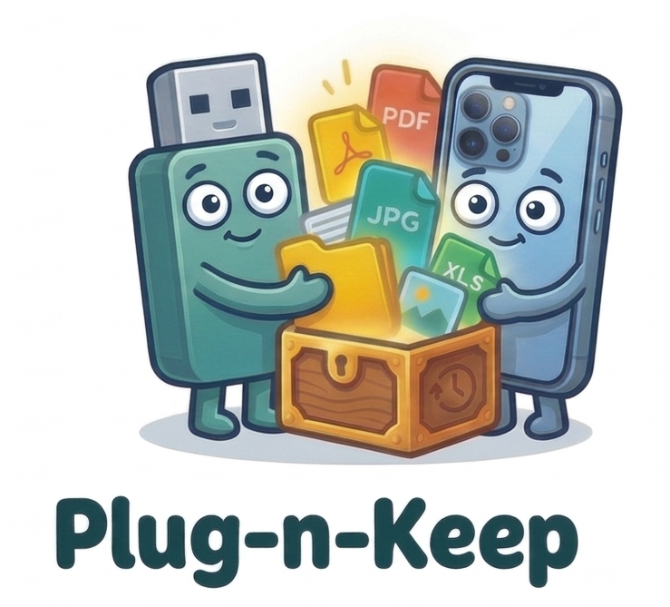
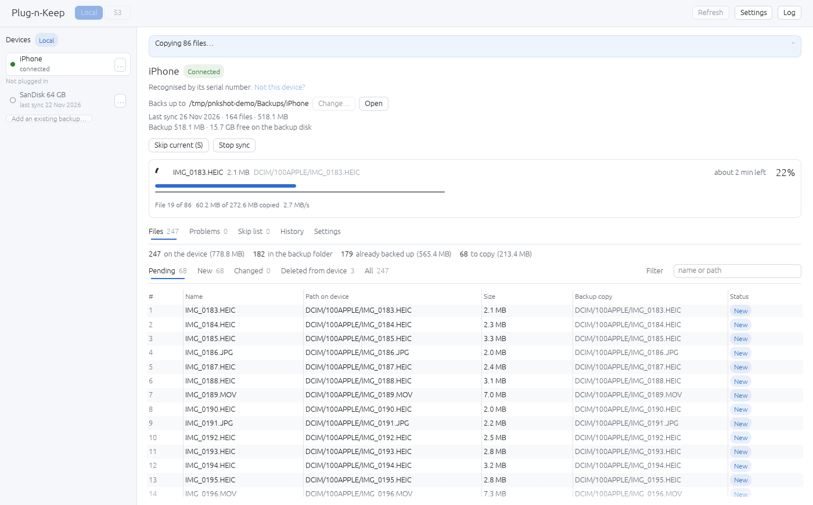
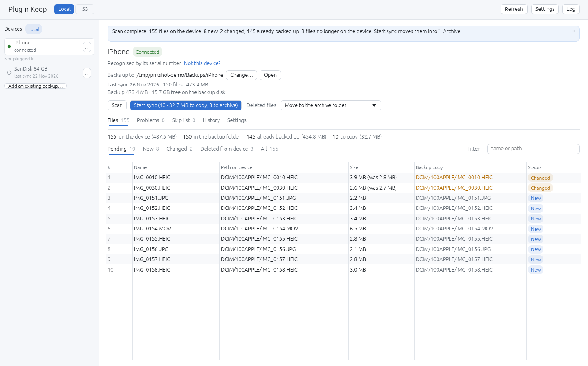
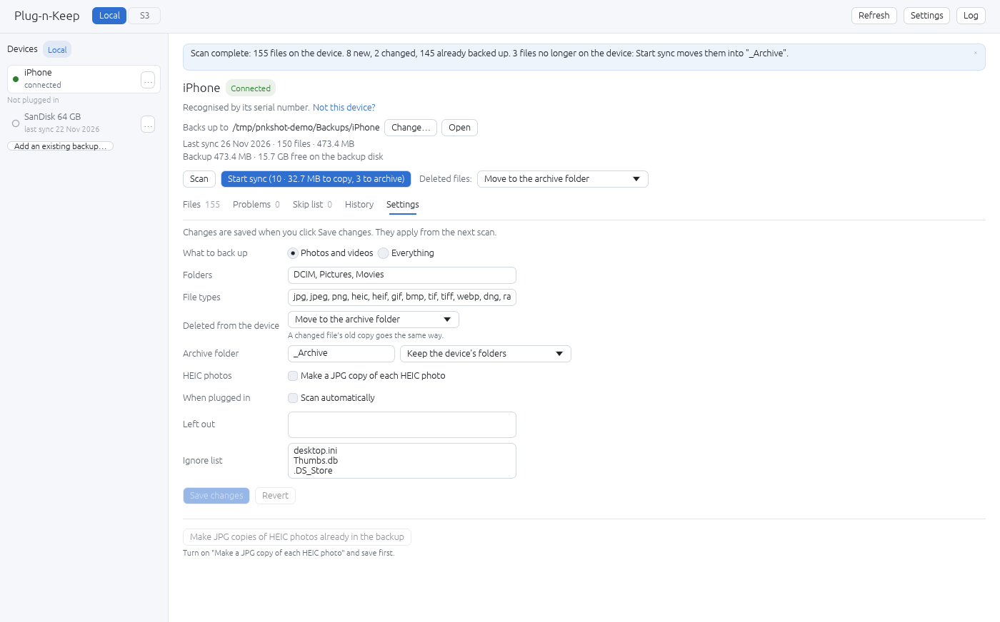
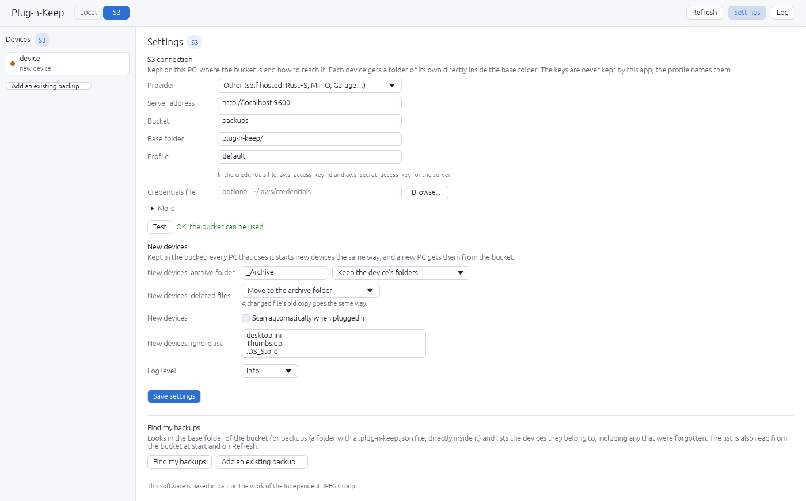

<p align="center">
  
</p>

<p align="center"><em>Plug it in. Keep everything.</em></p>

Plug-n-Keep is an app for Windows and Linux that backs up a USB device to a folder on the PC, or to
an S3 bucket, and keeps everything that was ever on it. A sync copies what is new to the backup.
Files deleted from the device are kept too. Nothing is ever deleted for good, and nothing on the device is changed.

<p align="center"><a href="assets/screenshot.png"></a></p>

## Supported devices

| | Windows | Linux | FreeBSD |
|---|---|---|---|
| USB sticks, cards and drives | yes | yes | yes |
| Android and iPhone | yes | yes (optional libraries) | no |
| Still cameras | yes | yes (optional library) | no |
| Eject | yes | yes | no, use the system's own |

A device with several storages (an Android phone with an SD card) gets a folder in the backup for each.

## Using it

The switch at the top of the window picks the mode: **Local** backs up to folders on the PC, **S3**
to folders in an S3 bucket. Each mode has its own list of devices and its own settings, so a device
set up in both is two devices, each with its own backup.

A scan shows what's new, changed and deleted before anything is copied.

<p align="center"><a href="assets/screenshot-scan.png"></a></p>

Each device has its own settings, including what happens to deleted files.

<p align="center"><a href="assets/screenshot-settings.png"></a></p>

- **Scan** only reads the device. Nothing is copied or archived until you press **Start sync**.
  **Stop** and **Skip current** leave no half-written file.
- **Eject** (sticks, cards and drives) lets go of the device, then asks the system to eject it, and
  says when it is safe to unplug.
- **Forget** only takes a device off the list. Its backup and everything in it stay, and
  **Add an existing backup…** brings it back.
- **Deleted files** are moved into an archive folder inside the backup by default. For each device
  you can instead leave them where they are, or (in Local mode) send them to the Recycle Bin (the
  Trash on Linux and FreeBSD). The old copy of a changed file is handled the same way. Nothing is
  ever permanently deleted: if a file can't go to the bin, it stays where it is.

## Local mode

Each device backs up to a folder on the PC, or on a drive plugged into it.

### Where it keeps its state

Everything about a device (its settings, what recognises it, its sync history and skip list) is in
its backup folder, in hidden `.plug-n-keep-*` files. The app's settings folder
(`%APPDATA%\plug-n-keep` on Windows, `~/.config/plug-n-keep` on Linux) only remembers where the
backup folders are and what new devices start with. Back up the backup folders and you have backed
up everything.

### Moving to a new computer

1. Copy the backup folder (or the folder that holds all of them) to the new computer.
2. Run Plug-n-Keep. Nothing else needs installing or restoring.
3. Click **Add an existing backup…** and pick the folder. Each device comes back with its settings
   and history.

## S3 mode

Each device backs up to its own folder in an S3 bucket, directly inside a base folder
(`<base folder>/<device name>/`). Several devices, and several PCs, can share one bucket.

Under **Settings**, pick the **Provider**, fill in what it asks for (named as the provider's own
pages name it), and press **Test**:

<p align="center"><a href="assets/screenshot-s3-settings.png"></a></p>

| Provider | Fields |
|---|---|
| Amazon S3 | Region, Bucket |
| Cloudflare R2 | Account ID, Bucket |
| Backblaze B2 | Endpoint, Bucket |
| Wasabi | Region, Bucket |
| Other (self-hosted: RustFS, MinIO, Garage…) | Server address, Bucket; under More: Region, Path-style addressing, CA file |

Every provider also has a **Base folder**, a **Profile** and a **Credentials file**.

- **Keys** are never typed into the app. They come from an AWS-style credentials file
  (`~/.aws/credentials`, or the file chosen in Settings) and the profile named in Settings, or from
  the `AWS_ACCESS_KEY_ID` and `AWS_SECRET_ACCESS_KEY` environment variables.
- **The service must support conditional writes**, which is how nothing is ever overwritten. The
  first connection checks this and refuses a service that doesn't. Only a self-hosted RustFS server
  has been tried for real so far.
- **Compared with a folder:** there is no Recycle Bin choice, the archive folder can't be renamed,
  **Copy address** takes the place of opening the folder, and with no network there is no scan or
  sync.

### Where it keeps its state

The bucket holds everything except the connection:

- **In the bucket:** each device's folder with its files and its hidden `.plug-n-keep-*` files (its
  settings, what recognises it, its history and skip list), and `.plug-n-keep-settings.json` in the
  base folder (what new devices start with, and the devices that were forgotten).
- **On the PC:** only the connection (provider, bucket, base folder, profile, credentials file
  path) in the `s3` folder inside the settings folder, and a copy of the device list to show
  while the bucket can't be reached.
- **The keys** stay in your credentials file.

### Moving to a new computer

1. Copy your credentials file to the new computer.
2. Run Plug-n-Keep, switch to **S3**, and in **Settings** enter the same connection. **Test**, then
   **Save settings**.
3. The devices, their settings and history, and what new devices start with all come from the
   bucket. A device that is plugged in is recognised straight away.

## Download

Ready-made builds for Windows and Linux are on the [Releases](https://github.com/sysadminmike/plug-n-keep/releases) page.

**Windows:** unzip and run `plug-n-keep.exe`. The exe isn't code-signed yet, so the first time
Windows SmartScreen may say "Windows protected your PC": click **More info**, then **Run anyway**.

**Linux** (x86_64, glibc 2.35 or newer, such as Ubuntu 22.04 and later): fetch the latest release
and unpack it.

```sh
v=$(curl -fsSLI -o /dev/null -w '%{url_effective}' https://github.com/sysadminmike/plug-n-keep/releases/latest); v=${v##*/v}
curl -fsSL "https://github.com/sysadminmike/plug-n-keep/releases/download/v$v/plug-n-keep-$v-linux-x86_64.tar.gz" | tar -xz
./plug-n-keep-$v/plug-n-keep
```

To install it for your user, `install -m 755 plug-n-keep-$v/plug-n-keep ~/.local/bin/`. Phone and
camera support needs a few optional packages; see [BUILD.md](BUILD.md#linux).

**FreeBSD:** there is no ready-made build yet, and FreeBSD support is so far only checked to
compile, not tested on a real machine. Fetch the latest source and build it (needs Rust 1.100 or
newer, from `pkg install rust` or rustup; see [BUILD.md](BUILD.md#freebsd)):

```sh
v=$(curl -fsSLI -o /dev/null -w '%{url_effective}' https://github.com/sysadminmike/plug-n-keep/releases/latest); v=${v##*/v}
curl -fsSL "https://github.com/sysadminmike/plug-n-keep/archive/refs/tags/v$v.tar.gz" | tar -xz
cd plug-n-keep-$v && cargo build --release && ./target/release/plug-n-keep
```

Checksums for each release are in its `SHA256SUMS.txt`.

## Build

```text
cargo build --release
```

See [BUILD.md](BUILD.md) for each platform's requirements, optional phone and camera libraries,
testing and the fake device.

## More

The design is in [DESIGN.md](DESIGN.md).

## Built with

- [egui and eframe](https://github.com/emilk/egui) draw the window (MIT or Apache-2.0). The fonts
  egui ships are under the SIL Open Font Licence and the Ubuntu Font Licence.
- [windows](https://github.com/microsoft/windows-rs) (MIT or Apache-2.0) reaches the Windows
  portable-device (WPD) and shell APIs; [zbus](https://github.com/dbus2/zbus) (MIT) asks udisks2 to
  eject on Linux; [rfd](https://github.com/PolyMeilex/rfd) (MIT) shows the file dialogs.
- HEIC photos are converted to JPG with the system's own decoders (WIC on Windows, libheif loaded at
  run time on Linux) and [jpeg-encoder](https://github.com/vstroebel/jpeg-encoder) (MIT or
  Apache-2.0). This software is based in part on the work of the Independent JPEG Group.
- [rusty-s3](https://github.com/paolobarbolini/rusty-s3) (BSD-2-Clause) signs S3 requests, and
  [ureq](https://github.com/algesten/ureq) (MIT or Apache-2.0) with rustls sends them.
- On Linux, libmtp, libimobiledevice with usbmuxd, libgphoto2 and libheif are optional, loaded at
  run time and not bundled.

The full list of third-party licences is in [THIRD-PARTY-NOTICES.md](THIRD-PARTY-NOTICES.md).

## Licence

MIT. See [LICENSE](LICENSE).
